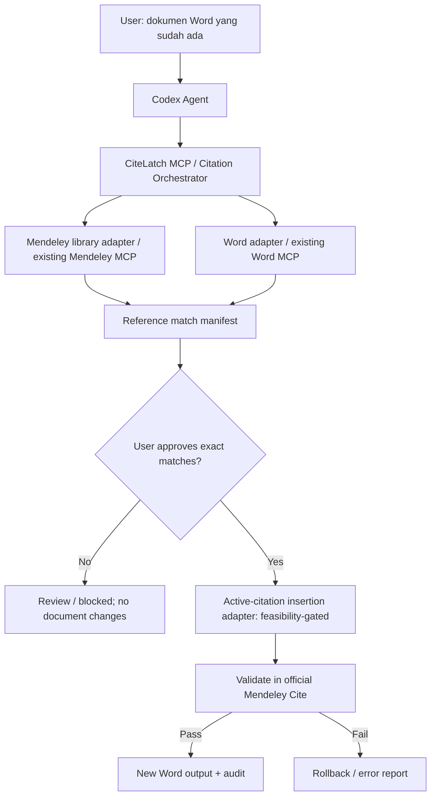

# Architecture & Technical Design (proposed; not validated)

## Core decision
Kita membangun **MCP server khusus Citation Bridge** untuk dikonsumsi Codex; Codex bukan dibangun ulang. Jangan langsung memutuskan mekanisme *insertion* sebelum eksperimen kompatibilitas Mendeley Cite.



## Module boundaries
1. `mcp_server`: MCP tools interface; schema validation; permission checks; job state.
2. `document_adapter`: read-only inspection, anchors/bookmarks/Word navigation; adapter for WordMcp or tested Office automation; must not assume hidden Word session coexists with visible Word.
3. `mendeley_adapter`: read-only lookup by DOI/title/year, metadata and optionally PDF; uses existing Mendeley MCP **or** authorized API adapter (no direct DB scraping).
4. `citation_matcher`: deterministic normalization + candidate ranking; model may assist in disambiguation but no hallucinated IDs.
5. `job_store`: manifest/journal, resume keys, version hash, audit trail; local by default.
6. `insertion_adapter`: *experimental* `mendeley_cite_ui` (visible Word/Windows UI automation) or **research-only** `docx_structure` (OOXML); no production enablement without tests.
7. `validator`: confirms actual editability with official Mendeley Cite after save/close/reopen, style switch and bibliography handling.

## Key insight: Citation formats differ
- Plain text `(Author, 2024)` = **not managed**.
- Microsoft Word's built-in `CITATION` field = **not equivalent** to Mendeley Cite.
- Old Mendeley Desktop Cite-O-Matic field = **not equivalent** to Mendeley Cite modern add-in.
- Modern Mendeley Cite citation is associated with add-in structures in `.docx` (some community tools study `w:sdt` content controls). Treat these observations as **undocumented, potentially version-dependent internals**, not a stable writing API.
- Mendeley API endpoints for library metadata are **not** the same as an API to command Mendeley Cite's UI.

## Important session lifecycle
The referenced `trsdn/mcp-server-word` runs Word invisibly and requires exclusive document access. **Never open the same document concurrently** in WordMcp session and Mendeley Cite visible UI session. Safe proposal: read/anchor working copy → `save` + `close` WordMcp → visible Word UI add-in insertion → save/close visible Word → read-only validate/reopen. Protect from stale file hashes and unexpected dialogs.

## Experimental mechanism selection
**Option 1 — Windows UI Automation (candidate A)**
- Control visible Word and Mendeley Cite pane using accessibility/UI automation.
- Pros: uses official add-in to create native controls; fewer assumptions about file internals.
- Cons: selectors fragile, focus/window scaling/dialog/ribbon changes; Office add-in may expose limited accessible controls; run locally with signed-in session.
- Required feasibility: log in → find reference → insert → save → reopen → edit citation → change style → update bibliography.

**Option 2 — OOXML structure injection (candidate B, research only)**
- Analyze controlled before/after `.docx` diff to learn Mendeley Cite semantics; write **disposable test docs only**.
- Pros: less UI dependence if feasible.
- Cons: add-in metadata, relationship IDs, control payloads, versioning; corruption or invisible uneditable control likely; no official compatibility guarantee.
- **Cannot claim feature works based solely on rendered text or presence of `MENDELEY_CITATION`-like tags.** Must pass official UI editability after reopen.

**Option 3 — first-party officially documented insertion API**
- Search official docs/SDK; if discovered with supported write contract, prefer it. **Currently unverified**; do not invent method names.

## Proposed MCP tools (names are OUR design, not implemented yet)
| Tool | Inputs (conceptual) | Output | Side effects |
|---|---|---|---|
| `inspect_document` | `docx_path` | `document_hash`, detected citations/anchors, compat warnings | No |
| `find_mendeley_reference` | `query`, optional DOI/folder | candidates with `document_id` + provenance | No |
| `prepare_citation_job` | `document_hash`, candidate mappings | dry-run manifest, conflicts | No |
| `approve_citation_job` | `job_id`, approved anchor→document IDs | approval snapshot | Metadata only |
| `insert_active_citation` | `job_id`, `anchor_id`, `reference_id`, `idempotency_key` | insertion status + evidence | Yes; controlled copy only |
| `refresh_bibliography` | `job_id`, selected style | bibliography status | Yes; controlled copy only |
| `verify_active_citations` | `job_id` | per-citation `verified/failed/unverifiable`, proof | Only UI read/test copy |
| `get_job_report` | `job_id` | audit JSON + human-readable report | No |

`insert_active_citation` is **a target capability**, not a guarantee. Until validated, return a `NOT_SUPPORTED_YET` or `FEASIBILITY_BLOCKED` result rather than faking success.

## Job state model
`DISCOVERED → MAPPED → NEEDS_REVIEW → APPROVED → BACKED_UP → INSERTING → VALIDATING → VERIFIED` or `BLOCKED` / `FAILED` / `ROLLED_BACK`.

Rules:
- Approval maps **exact** `anchor_id` to **exact** Mendeley `document_id`.
- Document hash invalidated after unexpected edits; require re-inspection.
- No second insertion if job/anchor verified; retries must not duplicate citation.
- After Word edit, re-resolve anchors; offsets are not durable. Prefer bookmarks/content-control anchors that are tested; preserve existing field structures.
- Never delete original plain-text citation until active replacement has passed preliminary checks on the working copy.

## Sample manifest shape
See `examples/citation-job.example.json`. Example IDs are dummy and must never be treated as actual bibliography records.

## Proposed repository after feasibility phase
```text
citelatch-mcp/
  AGENTS.md
  PROJECT_CONTEXT.md
  README.md
  src/citelatch_mcp/{server,adapters,matching,jobs,insertion,validation}/
  tests/{unit,integration,windows_e2e}/
  docs/decisions/
  fixtures/synthetic/
  harness/{discovery.md,test-results.md}
```

## Observability
- Log `job_id`, anchor, Mendeley document identifier **hash or minimally necessary ID**, action, result, elapsed, error code; avoid body text, PDFs, credentials.
- UI evidence screenshots may contain user data—store only in explicit local test folder with retention/permission controls.
- Error codes: `NO_MATCH`, `AMBIGUOUS_MATCH`, `SOURCE_UNVERIFIED`, `STALE_DOCUMENT`, `UI_NOT_ACCESSIBLE`, `ADDIN_NOT_AUTHENTICATED`, `CITATION_NOT_EDITABLE`, `WORD_LOCKED`, `ACTION_TIMEOUT`, `FEASIBILITY_BLOCKED`.
